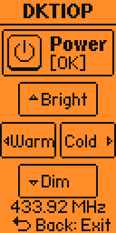

# DKTIOP Lamp Remote (Flipper Zero)

Graphical Flipper Zero Sub-GHz remote application built for the DKTIOP desktop lamp (`433.92 MHz`, `OOK 650kHz`, Princeton 24-bit protocol).

## Screenshot



## Recorded Sub-GHz Signals (`433.92 MHz`, Princeton 24-bit)

The original recorded `.sub` files are included under [`sub/`](sub/).

- **OK:** Power (`0xFF45`, `TE: 403`)
- **Up:** Bright + (`0xFF40`, `TE: 403`, hold for continuous TX)
- **Down:** Dim - (`0xFF15`, `TE: 403`, hold for continuous TX)
- **Left:** Warm (`0xFF44`, `TE: 404`)
- **Right:** Cold (`0xFF43`, `TE: 404`)
- **Back:** Exit

## Build & Install

Requires [`ufbt`](https://pypi.org/project/ufbt/):

```bash
ufbt
```

Copy `dist/dktiop_lamp_remote.fap` to `/ext/apps/Sub-GHz/dktiop_lamp_remote.fap` on your Flipper Zero microSD card.
